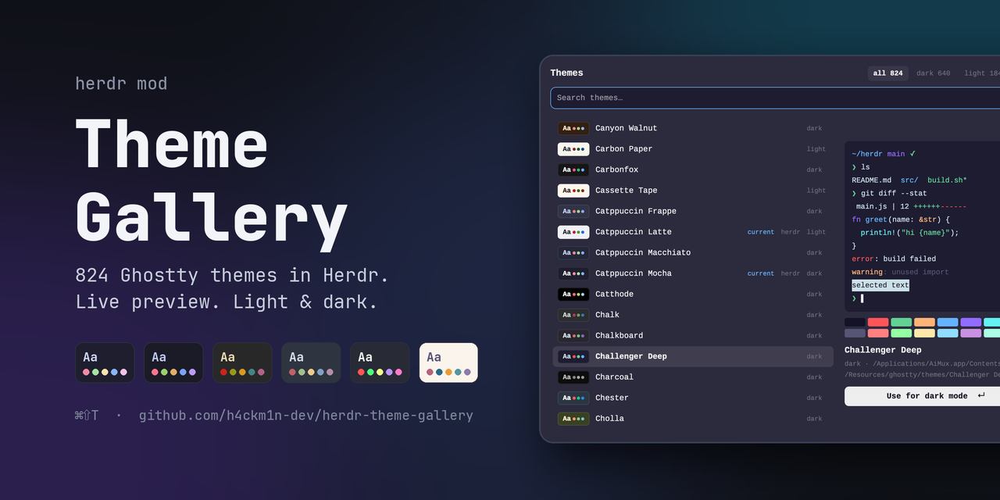
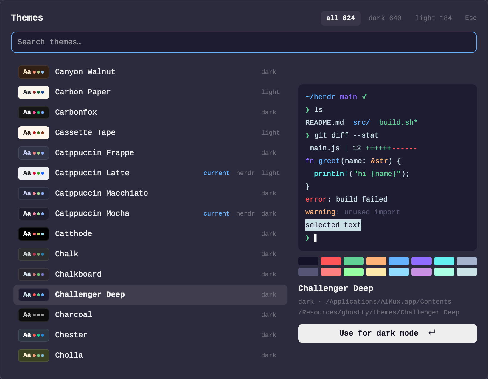
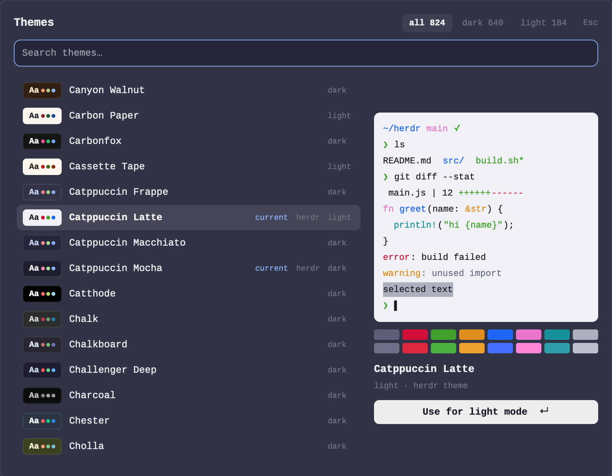

> **Moved to [h4ckm1n-dev/herdr-mods](https://github.com/h4ckm1n-dev/herdr-mods).** This repo is archived; install from there with `./install.sh`.

# Theme Gallery

**Every Ghostty theme, in [Herdr](https://herdr.dev).** Press <kbd>⌘</kbd><kbd>⇧</kbd><kbd>T</kbd> and browse more than 800 terminal themes. Herdr's own themes sit alongside the whole Ghostty collection. Move through the list and the whole app recolours as you go. Press Enter to keep a theme, or Esc to go back to the one you had.



<table>
<tr>
<td width="50%"></td>
<td width="50%"></td>
</tr>
<tr>
<td align="center"><sub>A dark theme, previewed live across the app</sub></td>
<td align="center"><sub>A light theme, previewed in the card while you're in dark mode</sub></td>
</tr>
</table>

## What you get

- **The whole collection.** It reads Ghostty's theme library from Ghostty.app, cmux or AiMux, plus your own `~/.config/ghostty/themes`, and lists those themes next to Herdr's. If two folders hold the same name, the first one wins, so your own themes override bundled ones.
- **Live preview.** <kbd>↑</kbd>/<kbd>↓</kbd> applies each theme to the whole window as you move. Esc, a click outside or closing the popup puts your old light and dark themes back.
- **A preview card.** A small fake terminal shows a prompt, `ls`, a diff, some code, error and warning lines, a selection and the cursor, all in the theme's own colours, with its 16-colour palette underneath. It works for light themes even while you're in dark mode.
- **Light and dark kept apart.** Herdr keeps one theme for each appearance. Choosing a dark theme sets your dark half and leaves the light half alone, the same as cmux's `themes set --light/--dark`. The button says which half you're changing.
- **Search and filter.** Type to filter. Tab or the chips switch between **all**, **dark** and **light**.
- **No clutter.** A Ghostty theme becomes `themes/<name>.json` only when you preview it. Files for themes you didn't keep are deleted when the gallery closes, so Herdr's Settings lists only the themes you chose.

## Install

Ask the agent in Herdr:

> add herdr.dev/mods/h4ckm1n-dev/herdr-theme-gallery

Or do it by hand:

```sh
git clone https://github.com/h4ckm1n-dev/herdr-theme-gallery
cp -R herdr-theme-gallery/mods/theme-gallery ~/.config/herdr-app/mods/
herdr-app check ~/.config/herdr-app/mods/theme-gallery
```

Then add the key to the `global` section of `~/.config/herdr-app/keys.json`:

```json
"cmd-shift-t": "mod.open:theme-gallery"
```

Or open it without a key: `herdr-app do mod.open --name theme-gallery`.

**Needs:** Herdr app, `python3`, and at least one Ghostty theme folder (Ghostty, cmux or AiMux installed, or your own `~/.config/ghostty/themes`). Without any of these, the gallery still lists Herdr's own themes.

## Keys

| Key | Does |
|---|---|
| type | filter by name |
| <kbd>↑</kbd> <kbd>↓</kbd> · <kbd>PgUp</kbd> <kbd>PgDn</kbd> | move the selection and preview it |
| <kbd>Tab</kbd> / <kbd>⇧</kbd><kbd>Tab</kbd> | all → dark → light |
| <kbd>Enter</kbd> · click the selected row · **Use** | keep this theme |
| <kbd>Esc</kbd> | close and put the old themes back |

It also takes the commands `theme-gallery.next`, `theme-gallery.prev` and `theme-gallery.use`. You can bind them in `keys.json` or run them from a shell with `herdr-app do`.

## Where themes come from

`scan.py` searches these folders in order:

1. `$GHOSTTY_RESOURCES_DIR/themes`
2. `~/.config/ghostty/themes` and `~/Library/Application Support/com.mitchellh.ghostty/themes`
3. the cmux / AiMux theme folders under `~/Library/Application Support`
4. the copies bundled in `AiMux.app`, `cmux.app` and `Ghostty.app` under `/Applications`
5. on Linux: `ghostty/themes` under each `$XDG_DATA_DIRS` entry (default `/usr/local/share:/usr/share`)

Each Ghostty theme becomes a Herdr theme like this:
- `background` and `foreground` carry over as they are;
- `selection-background` becomes `selection`, or a 25% mix of the background and foreground when the theme has none;
- `cursor-color` becomes `cursor`;
- `palette = 0..15` becomes `ansi`, with xterm defaults filling any missing slot.

Herdr derives its panel colours from these.

## Privacy

Everything stays on your machine, and the mod makes no network calls. It **runs** `python3` (its own `scan.py`) and `rm`. It **reads** the theme folders listed above. It **writes** and deletes only files in `~/.config/herdr-app/themes/`, and only the ones it created itself.

## Good to know

- **Light themes in dark mode.** A light theme previews in the card, but the app only changes once the system is in light mode, because Herdr shows the theme for the current appearance.
- **Herdr's themes win.** A theme that's already in Herdr, or that you've kept before, is shown from Herdr's copy and tagged `herdr`. The themes you're using now are tagged `current`.
- **Saving `main.js` while the gallery is open** hot-reloads the mod without the cleanup step. A previewed theme and its file stay until you pick again.

## Build it yourself

[`RECIPE.md`](RECIPE.md) describes the mod precisely enough for an agent to rebuild it from an empty folder: its layout, colours, behaviour, what it's built from, its limits and how to check it works.
