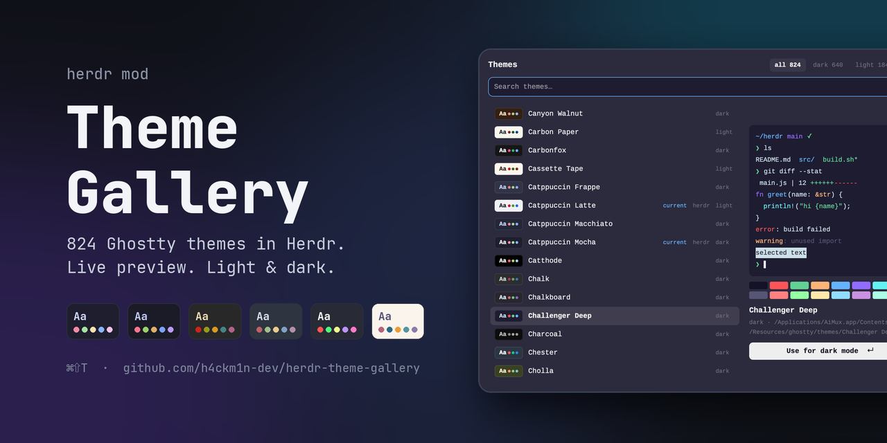

# Theme Gallery

A popup listing every terminal theme the machine has: Herdr's own and the whole Ghostty collection (Ghostty.app, cmux, AiMux, `~/.config/ghostty/themes`). Each theme has a swatch. Moving the selection recolours the whole Herdr window live, a card shows the selected theme as a small terminal, Enter keeps it and Esc puts the previous themes back.

## What you see

A popup at the top of the window (`kind: "popup"`, `at: "top"`, offset 40, 820 wide, `popover` background, 18px padding, 10px gaps, 13px text):

- **Header row:** `Themes` (15px semibold, `foreground`) on the left. On the right, three chips `all 824`, `dark 640`, `light 184` (11.5px, 9×3 padding, 6px radius). The active chip is on `hover` in `foreground` semibold, the others are `dim`. After them, `Esc` (11px, `dim`).
- **Search field:** 36px tall, 9px radius, 1px `accent` border on `background`, placeholder `Search themes…`, 12.8px text. It has focus when the popup opens.
- **Status line** (only while loading or on error): `Loading the Ghostty collection…` or `Ghostty collection unavailable: <why>`, 11.5px `dim`.
- **Body, 520px tall:** a list 468px wide on the left, a 16px gap, then the preview card (300px) on the right.
  - **Rows (34px, 7px radius, 4px side margin, 8px padding, 10px gap):** a 52×22 swatch (5px radius, 1px `border`) in the theme's background, holding `Aa` (11px semibold, theme foreground) and three 5px dots in ansi 1, 2 and 4. Then the name (truncated, `foreground`, semibold when selected), then optional tags at 10.5px: `current` in `accent`, `herdr` in `dim`, and the lightness `dark`/`light` (`dim`, 36px, not shrinking). The selected row sits on `selected` (or `hover` if the theme has none). A vertical scrollbar overlays the list.
  - **Preview card:** a fake terminal (12px padding, 8px radius, the theme's background, the terminal font from `settings().font_family`, 12px) drawing these lines in the theme's colours:
    - `~/herdr` (ansi4), `main` (ansi5), `✓` (ansi2);
    - `❯ ls`, then `README.md` in the foreground, `src/` in ansi4 and `build.sh*` in ansi2;
    - `❯ git diff --stat`, then `main.js | 12` with `++++++` in ansi2 and `------` in ansi1;
    - a Rust `fn greet` with `fn` in ansi5, the name in ansi4, `&str` in ansi3, `println!` in ansi6 and the string in ansi2;
    - `error` in ansi1, and `warning` in ansi3 with its message in ansi8;
    - `selected text` on the theme's selection colour, its text whichever of foreground or background contrasts more;
    - a prompt with a `▌` cursor in the cursor colour.

    Under it, the 16-colour palette as two rows of 8 (14px tall, 3px radius, 4px gaps). Then the theme name (14px semibold), `dark · <source file>` or `· herdr theme` (11px `dim`), and a 32px button `Use for dark mode ↵` / `Use for light mode ↵` on `solid` / `solid_foreground`.
  - **No match:** `No theme matches.` in `dim` where the card would be.

## How it behaves

- The popup opens on the theme showing now: `settings().theme_dark` or `theme_light`, depending on `settings().dark`.
- **Moving** (↑/↓, PgUp/PgDn ±10, a row click, typing, a chip, Tab/⇧Tab to cycle modes) changes the selection. After 140ms without another move it previews: it writes `themes/<name>.json` if missing, then runs `app.theme {name}`, which sets the half matching the theme's lightness. A theme that's already picked for its half isn't re-applied.
- **Keeping:** Enter, a click on the already-selected row, or the Use button. If the preview hasn't landed yet, Use applies it first, then closes.
- **Leaving without keeping** (Esc, a click outside, `overlay.close`): `close()` runs `app.theme` with the original value of every half that changed.
- **Cleanup on every close:** theme files the gallery created are deleted with `rm -f`, except the ones now picked for light or dark. Files that existed before are never touched.
- **Mod commands:** `theme-gallery.next`, `.prev` and `.use` arrive through `nextCommand()` and act like ↓, ↑ and Enter.
- Agent statuses don't apply; the popup shows no agents.

## Built from

- `mods/theme-gallery/mod.json`: `{"place":"none","title":"Themes","overlay":{"kind":"popup","at":"top","offset":40,"width":820,"height":0.8}}`. It's opened with `mod.open:theme-gallery`, bound to `cmd-shift-t` in `keys.json`'s `global` section.
- **`scan.py`** (stdlib Python, run with `python3 -I`) prints JSON `[{name, src, dark, background, foreground, selection, cursor, ansi[16]}]`.
  - **Search order** (the first folder holding a name wins, case-insensitive):
    1. `$GHOSTTY_RESOURCES_DIR/themes`
    2. `~/.config/ghostty/themes`
    3. `~/Library/Application Support/{com.mitchellh.ghostty,la.sabaidev.aimux,com.cmuxterm.app}/themes`
    4. `/Applications/{AiMux,cmux,Ghostty}.app/Contents/Resources/ghostty/themes`
    5. `$XDG_DATA_DIRS/ghostty/themes` (default `/usr/local/share:/usr/share`)
  - **Parsing** is Ghostty's `key = value` format:
    - `background` and `foreground` are required;
    - `selection-background` falls back to a 25% background→foreground mix;
    - `cursor-color` falls back to the foreground;
    - each `palette = N=#hex` fills ansi slot N, with xterm defaults for missing slots;
    - hex can be 3 or 6 digits;
    - `dark` means luminance (0.299R+0.587G+0.114B)/255 below 0.5.
- **`main.js`:**
  - **Libraries:** `View`/`div` from gpui-kit; `v_flex`, `h_flex`, `InputState`, `Input`, `v_virtual_list`, `VirtualListScrollHandle` and `Scrollbar` from gpui-base.
  - **herdr functions:** `theme()`, `themes()` (Herdr's presets and `themes/*.json`, listed first and winning name clashes), `settings()`, `run("app.theme")`, `exec`, `appHome()`, `readTextFile`, `writeTextFile`, `props()`/`closeOverlay` and `nextCommand()`.
  - **Writing a theme file:** `{background, foreground, selection, cursor, ansi}` as pretty JSON, created with `writeTextFile(path, text, null)`.

## Watch out

- **Rows in a `v_virtual_list` can't register handlers.** An `on_click`/`.id()` inside the item renderer throws and the list draws empty. `herdr-app check` doesn't run deferred rows, so it still passes. Use the list's `on_item_click((key, cx) => …)` with the theme name as the key.
- **The popup sizes itself to its content.** A `flex_1` body collapses to 0 height, and a virtual list takes its width from a row, so give the body a fixed height (520) and the list and rows fixed widths (468 / 460).
- **`settings().theme` isn't the user's pick.** Use `settings().theme_light` / `theme_dark`. Don't read `layouts/.state/`, which Herdr owns.
- **`app.theme` changes only the half matching the theme's lightness.** A light theme previewed in dark mode changes nothing visible, which is why the card exists.
- **Don't keep a `cx`.** Pass each callback's `cx` into `moved`/`use`/`step`.
- **Name your own close method anything but `close`.** `close()` is Herdr's cleanup hook; it has 250ms, so it only runs `app.theme` and one `rm`.
- **Hot-reloading `main.js` while the popup is open** skips the old copy's `close()`, so a preview and its file can be left behind.
- **Limits:** about 820 themes and about 300KB of JSON from `scan.py` (about 0.15s). Names containing `/` would break the file path; Ghostty has none.

## Done when

- `herdr-app check ~/.config/herdr-app/mods/theme-gallery` passes.
- `herdr-app do mod.open --name theme-gallery` shows the popup with roughly 824 rows, opened on the current theme and tagged `current`.
- `herdr-app do theme-gallery.next` changes the shown dark (or light) theme within about half a second, and `themes/<that name>.json` appears.
- `herdr-app do overlay.close` after a few `next` commands restores the original `theme_light`/`theme_dark`, and the preview files are gone.
- Opening, `next`, then `theme-gallery.use` keeps the new theme and its file after the popup closes.
- `herdr-app shot` shows rows with swatches, and a card whose `selected text` stays readable on themes with a light selection (Challenger Deep).
